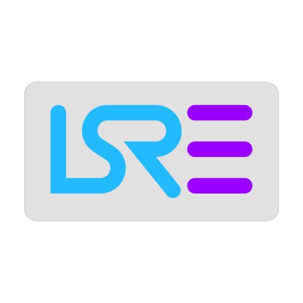

<p align="center"></p>

# LSRE — Light Start Reverse Engineering

Один исполняемый файл для Windows: реверс-инжиниринг бинарников через MCP, с локальной
памятью между сессиями. Внутри — движок REA 6.7.0, Ghidra, Frida, сигнатуры YARA-X
и парсеры форматов Kaitai.

```
[агент] ⇄ MCP ⇄ LSRE.exe ⇄ REA ⇄ Ghidra / Frida / YARA-X / Kaitai
                        ⇄ SQLite: факты, граф, якоря, страницы
```


## Что нового в 2.1.2

- **lsre_parse_yaml**: YAML → JSON с координатой ошибки, безопасный режим (1 МБ, запрет опасных тегов). Размер exe не вырос.

## Что нового в 2.1.1

- **Frida прогревается при старте** — первый инструментальный вызов без задержки, статус в lsre_frida_status.
- **Консолидация памяти** lsre_memory_consolidate: близкие факты (косинус ≥ 0.8) собираются в наблюдение с числом подтверждений; исходные записи сохраняются.

## Что нового в 2.1.0

- **Локальные эмбеддинги без сети.** Внутри exe — rubert-tiny2 int8 (312 измерений, 27,9 МБ).
  Инструмент `lsre_embed` даёт вектор текста или косинус двух текстов; на CPU ~2 мс/текст.
- **Гибридный recall.** Память ищет сразу двумя каналами — FTS5 (bm25) и вектор — и сливает
  результаты через reciprocal rank fusion. Перефразировки больше не теряются.
- **Схема памяти v4:** таблица `embeddings`, вектор считается при сохранении факта.
- **Запасной каталог памяти:** если системная папка недоступна, база уходит в `~/.lsre/memory`,
  а не падает.
- **Защита от DoS в токенизаторе:** длинные «слова» режутся, текст ограничен 4000 символов.
- **Всего 98 инструментов:** 83 REA + 15 LSRE (память, граф, якоря, страницы, триаж PE,
  YARA-X, Kaitai-парсеры, эмбеддинги).
- **Проверено 17 критическими тестами:** функции, битые входы, path traversal, SQL-инъекции,
  вырезание секретов, гигантские тексты, битые правила YARA, каталог вместо файла.

## Что это

LSRE упаковывает инструменты реверс-инжиниринга в один самодостаточный exe:

- **не требует установки**: первый запуск распаковывает окружение в `%LOCALAPPDATA%\LSRE`
  и работает оттуда; Node, npm и Python на машине не нужны;
- **говорит по MCP**: подключается к Claude, Cursor, Codex, DSH, OpenCode и любому
  MCP-клиенту одной строкой конфигурации;
- **помнит работу**: факты, граф зависимостей, якоря сессий и страницы знаний хранятся
  локально в SQLite и доступны агенту через инструменты памяти;
- **считает структуру, а не байты**: триаж PE, сигнатуры YARA-X и Kaitai-парсеры дают
  агенту именованные поля вместо «прочитай 40 байт и догадайся».

## Возможности

| Направление | Что внутри |
|---|---|
| Статический анализ | Ghidra 12.1.4 (headless), псевдокод, xrefs, граф вызовов, аннотации |
| Триаж файла | PE: секции и энтропия по каждой, импорты, overlay, TLS, .NET, время сборки, подозрение на упаковщик с уверенностью и уликами |
| Сигнатуры | YARA-X 1.22 и набор правил: AES S-box, SHA-256, MD5, Base64, UPX, MPRESS, анти-отладка, zlib, OpenSSL |
| Форматы | Kaitai-парсеры: PNG, SQLite 3, gzip, pcap — именованные поля вместо смещений |
| Динамика | Frida 17.24: устройства, сессии, скрипты, перехват |
| Мосты | IDA, Cutter, JEB, Kuna, Android/ADB |
| Артефакты | APK, WASM, .NET, Go, Rust, Mach-O, SQLite, pcap |
| Память | факты с дедупликацией, граф `calls/contains/duplicates/depends_on`, якоря сессий, страницы знаний |
| Визуал | локальная карта связей `LSRE.exe ui` с ручной правкой и сохранением позиций |
| Панель | `LSRE-lens`: окно по Ctrl+Alt+Shift+A, текст и голос (Win+H), захват области |

Инструментов в MCP: **101** (83 REA + 18 LSRE). Схемы компактные: каталог занимает около 75 КБ вместо 3 МБ
у стандартной поставки REA.

## Чем отличается от «голого» REA

| Параметр | REA 6.7.0 как есть | LSRE 2.1.0 |
|---|---|---|
| Запуск | `npx rea-agents` — резолв пакета в npm при каждом старте | локальный exe, обращений к сети нет |
| Каталог инструментов | 207 инструментов, ~3084 КБ схем в каждом запросе | 98 инструментов, ~75 КБ схем |
| Установка | нужен Node и npm | один файл, изолированное окружение |
| Память между сессиями | нет в поставке | SQLite: факты, граф, якоря, страницы |
| Триаж файла | нет | `lsre_file_triage` с энтропией по секциям |
| Сигнатуры | `search_bytes` по маске | YARA-X + собственные правила |
| Форматы | ручное чтение байтов | Kaitai-парсеры с именованными полями |
| Визуализация связей | нет | `LSRE.exe ui` |
| Происхождение связей | нет понятия | `origin: ai/user`, связи человека не перезаписываются |

## Чем отличается от отдельных инструментов

| Задача | Ghidra | Frida | IDA | LSRE |
|---|---|---|---|---|
| Работает без установки | нет (JDK + 400 МБ) | нет (Python/CLI) | нет | да |
| Интерфейс для ИИ-агента | нет | нет | через плагин | нативный MCP |
| Память между сессиями | нет | нет | нет | да |
| Триаж упаковщика до анализа | вручную | — | вручную | одной командой |
| Сигнатуры по запросу | нет | нет | YARA-плагин отдельно | встроено |
| Стоимость | бесплатно | бесплатно | платно | бесплатно, MIT |

LSRE не заменяет эти инструменты: он вызывает Ghidra и Frida и добавляет к ним
агентский интерфейс, память и подготовительные слои.

## Быстрый старт

1. Скачайте `LSRE.exe` из [Releases](../../releases).
2. Подключите к агенту:

```json
{
  "mcpServers": {
    "lsre": { "command": "C:\\Tools\\LSRE.exe", "args": [] }
  }
}
```

3. Проверьте установку:

```powershell
.\LSRE.exe --version
.\LSRE.exe doctor --json
```

Первый запуск распаковывает окружение (~500 МБ) в `%LOCALAPPDATA%\LSRE\6.7.0-lsre2`
и занимает 20–60 секунд. Повторные запуски мгновенные.

Для глубокого анализа нужны Ghidra 12.1.4 и JDK 21 — они ставятся отдельно, пути задаются
переменными `GHIDRA_INSTALL_DIR` и `JAVA_HOME`. Frida, YARA-X и Kaitai уже внутри.

## Устройство

| Слой | Реализация |
|---|---|
| Упаковка | Node SEA: архив окружения вшит в exe, распаковка при первом запуске |
| Диспетчер | MCP-прокси: фильтр инструментов, память, ленивая загрузка тяжёлых модулей |
| Память | SQLite + FTS5: `facts`, `entities`, `edges`, `sessions`, `pages`, `node_positions` |
| Тяжёлые движки | Ghidra — внешний процесс; YARA-X — `yr.exe` внутри; Kaitai — скомпилированные парсеры |
| Визуал | локальный HTTP-сервер на 127.0.0.1, Cytoscape |

Подробнее — [docs/ARCHITECTURE.md](docs/ARCHITECTURE.md).

## Что скачать дополнительно (~700 МБ)

LSRE работает сразу после скачивания: триаж, сигнатуры YARA-X, парсеры Kaitai и память
не требуют ничего. Для глубокого статического анализа нужны два внешних пакета —
они не входят в exe из-за размера:

| Программа | Версия | Размер | Ссылка |
|---|---|---|---|
| **Ghidra** | 12.1.4 PUBLIC | ~400 МБ (zip) | https://github.com/NationalSecurityAgency/ghidra/releases |
| **JDK 21** (Eclipse Temurin) | 21 LTS, Windows x64 | ~190 МБ (zip) | https://github.com/adoptium/temurin21-binaries/releases |

Итого около 700 МБ загрузки и ~1 ГБ на диске после распаковки. Оба архива распаковываются
в любую папку, установка в систему не нужна.

После распаковки укажите пути:

```powershell
$env:GHIDRA_INSTALL_DIR = "C:\Tools\ghidra_12.1.4_PUBLIC"
$env:JAVA_HOME          = "C:\Tools\jdk-21"
.\LSRE.exe doctor --json    # покажет, нашлась ли Ghidra
```

Без этих пакетов LSRE тоже работает: Frida, YARA-X, Kaitai, память, визуал и триаж
доступны полностью, а инструменты Ghidra вернут понятное сообщение о ненайденном движке.
## Замеры

Только измеренные значения, на одной машине (Windows 11, x64). Что именно измерено — в колонке
«область».

| Показатель | REA | LSRE 2.1.0 | Разница | Область |
|---|---|---|---|---|
| Каталог инструментов | 207 инструментов / 3084,3 КБ схем | 98 / 75,8 КБ | **−97,5 %** | накладные расходы каждого запроса |
| Каталог, compact-режим REA | 207 / 214,1 КБ | 98 / 75,8 КБ | −64,6 % | то же |
| Триаж `notepad.exe` до анализа | Ghidra: 243,0 с, ответ 14 423 б | `lsre_file_triage`: 3,0 мс, ответ 3 686 б | −74,4 % по ответу | время до первого решения |
| Kaitai-парсинг PNG | — | 0,3 мс, ответ 0,2 КБ | — | один вызов вместо чтения байтов |
| Kaitai-парсинг SQLite | — | 0,4 мс, ответ 0,6 КБ | — | то же |
| Якорь сессии | — | 247 байт | — | вход в новую сессию |

Что это значит на практике:

- **−97,5 %** — это про фиксированную плату за каталог схем в каждом запросе, а не про общий
  расход токенов на задачу. Основной расход в реверс-инжиниринге дают ответы инструментов
  (декомпилированный код, списки функций) и число шагов, а не каталог.
- **243 с против 3 мс** — разные операции: Ghidra импортирует файл и делает анализ, триаж только
  читает заголовки. Сравнение честно для вопроса «нужен ли тяжёлый анализ».
- **Kaitai** экономит шаги: один вызов даёт именованные поля вместо нескольких чтений по смещениям.

## Требования

- Windows 10/11 x64.
- Для Ghidra: JDK 21 и Ghidra 12.1.4 отдельно.
- Для голосового ввода в панели: включённый голосовой ввод Windows (Win+H).

## Ограничения

- Исполняемый файл не подписан: SmartScreen предупреждает о неизвестном издателе.
- Нативной сборки под Windows on ARM нет; x64-версия работает через эмуляцию.
- Парсеры Kaitai покрывают четыре формата; PE/ELF/ZIP — в работе.
- Поиск в памяти полнотекстовый, без векторных эмбеддингов.
- Провайдеры IDA, JEB, Cutter, Kuna требуют собственных установленных движков.

## Дорожная карта

- [ ] Kaitai: PE, ELF, ZIP.
- [ ] Консолидация памяти: слияние дублей, TTL, лимиты банков.
- [ ] Защита от параллельного запуска (lock распаковки).
- [ ] Нативная сборка arm64.
- [ ] Подпись исполняемого файла.

## Лицензия и происхождение

LSRE © 2026 SalawatKoz, MIT. Основа — REA 6.7.0 (MIT, © morluto, https://github.com/morluto/rea).
Текст лицензии — [LICENSE](LICENSE), сторонние компоненты и их лицензии — [NOTICE.md](NOTICE.md).
Позиция проекта — [POLICY.md](POLICY.md): инструмент исследования и обучения, без обхода
технических средств защиты и без распространения чужого кода.
