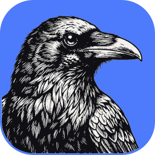
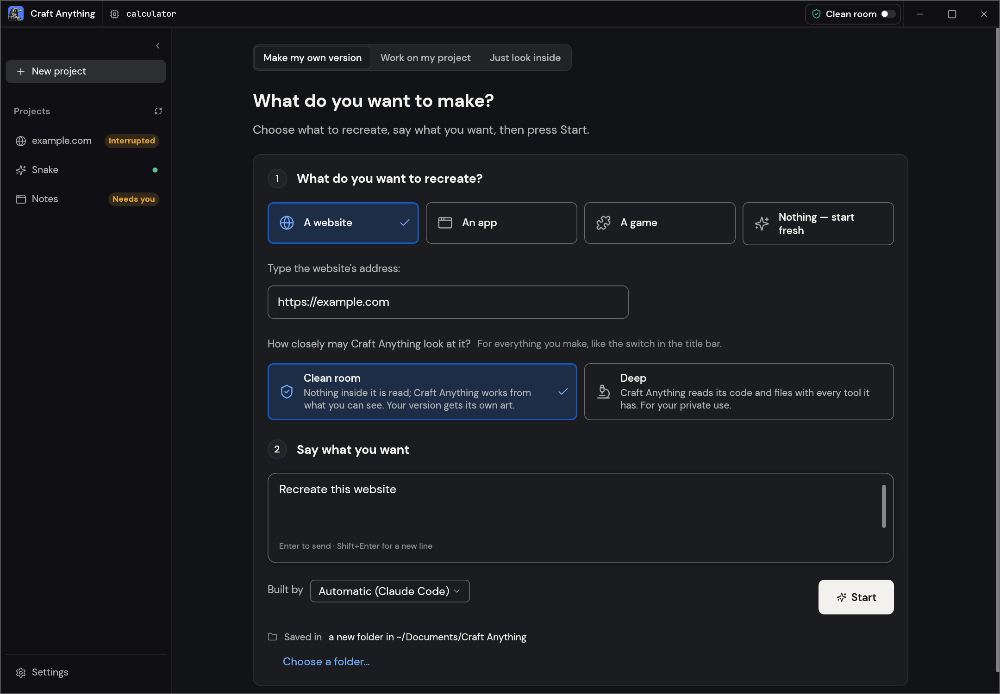

<!-- ไฟล์นี้เป็นฉบับแปลภาษาไทยของ README.md หากต้นฉบับภาษาอังกฤษมีการเปลี่ยนแปลง โปรดอัปเดตไฟล์นี้ด้วย -->

<p align="center">
  <a href="https://getartcraft.com/">
    <picture>
      <source media="(prefers-color-scheme: dark)" srcset="docs/brand/artcraft-logo-white.svg">
      
    </picture>
  </a>
</p>

<p align="center">
  
</p>

<h1 align="center">Craft Anything</h1>

<p align="center">
  <a href="README.md">English</a> · <a href="README.ja.md">日本語</a> · <a href="README.zh.md">简体中文</a> · <a href="README.zh-hant.md">繁體中文</a> · <a href="README.ko.md">한국어</a> · <a href="README.es.md">Español</a> · <a href="README.fr.md">Français</a> · <a href="README.vi.md">Tiếng Việt</a> · <a href="README.pt.md">Português</a> · <b>ไทย</b>
</p>

<p align="center">
  <b>ดูว่าเว็บไซต์ แอป หรือเกมใดๆ ทำงานอย่างไร แล้วให้ AI สร้างเวอร์ชันของคุณเอง เอนจิน Clean-room แบบโอเพนซอร์ส เขียนด้วย Rust ล้วน</b><br>
  เพียงชี้เป้าหมาย ระบุสิ่งที่คุณต้องการ แล้วระบบจะศึกษาตัวต้นฉบับด้วยเครื่องมือตรวจสอบจริง<br>
  ให้ coding agent สร้างโปรเจกต์ใหม่ ตรวจสอบผลลัพธ์เทียบกับต้นฉบับ และปรับแต่งให้สมบูรณ์
</p>

<p align="center">
  
  
  
  
  <br>
  <a href="https://sonarcloud.io/project/overview?id=storytold_craft-anything"></a>
  <a href="https://coderabbit.ai"></a>
</p>

<p align="center">
  <a href="https://discord.gg/artcraft"></a>
</p>

<p align="center">
  <a href="#ดาวน์โหลด"><b>ดาวน์โหลด Craft Anything</b></a> ·
  <a href="https://getartcraft.com/">ArtCraft</a> ·
  <a href="https://getartcraft.com/apps">แอป Crafting ทั้งหมด</a>
</p>

<br>

<p align="center">
  
  <br>
  <sub>โปรเจกต์เว็บไซต์: การตรวจสอบแต่ละข้อจะบอกว่าสิ่งที่สร้างเหมือนแค่ไหน คุณเป็นผู้อนุมัติสิ่งใดก็ตามนอกกฎ และแผนงานจะแสดงขั้นตอนที่เหลือ</sub>
</p>

> [!NOTE]
> **ArtCraft คือชุมชนของศิลปินและนักสร้างสรรค์จากทุกสาขาอาชีพ** จิตรกร ช่างภาพ
> คนทำหนัง นักวาดภาพประกอบ ดีไซเนอร์ แอนิเมเตอร์ ผู้ทำงานอดิเรก และคนที่เพิ่งหยิบดินสอขึ้นมาเมื่อสัปดาห์ที่แล้ว
> หากคุณสร้างสรรค์สิ่งต่างๆ คุณคือหนึ่งในพวกเรา **[แวะมาทักทายกันบน Discord](https://discord.gg/artcraft)**

<p align="center">
  <a href="#การทำงาน">การทำงาน</a> ·
  <a href="#รูปแบบการใช้งานสองแบบ">รูปแบบการใช้งานสองแบบ</a> ·
  <a href="#ai">AI</a> ·
  <a href="#สร้างมาเพื่อเอเจนต์">เอเจนต์</a> ·
  <a href="#เบื้องหลังการทำงาน">เบื้องหลัง</a> ·
  <a href="#เริ่มต้นใช้งาน">เริ่มต้นใช้งาน</a> ·
  <a href="#สถานะของโปรเจกต์">สถานะ</a> ·
  <a href="#ดาวน์โหลด">ดาวน์โหลด</a> ·
  <a href="https://discord.gg/artcraft">Discord</a>
</p>

<br>

<table>
  <tr>
    <td width="25%" valign="top">
      <h3>🔍 ศึกษาได้ทุกอย่าง</h3>
      เว็บไซต์ แอปเดสก์ท็อป แอปมือถือ เกม และไฟล์ต่างๆ: เครื่องมือตรวจสอบจริงจะค้นหาว่าสิ่งเหล่านั้นสร้างขึ้นอย่างไรและทำอะไรบ้าง พร้อมหลักฐานสนับสนุนทุกคำตอบ
    </td>
    <td width="25%" valign="top">
      <h3>🛠️ สร้างเวอร์ชันของคุณเอง</h3>
      บอกสิ่งที่คุณต้องการ ("สร้างเว็บไซต์นี้ขึ้นมาใหม่", "สร้างระบบการเล่นของเกมนี้ขึ้นมาใหม่ด้วย Rust") แล้ว coding agent จะสร้างโปรเจกต์ใหม่ในสแตกเทคโนโลยีที่คุณระบุ
    </td>
    <td width="25%" valign="top">
      <h3>✅ ผ่านการตรวจสอบ ไม่ใช่แค่การเดา</h3>
      ทุกชิ้นงานที่สร้างจะถูกนำมาเปรียบเทียบกับต้นฉบับ (หน้าเว็บที่ความกว้างหน้าจอ 3 ขนาด, การทดสอบตัวเองของเกม, การรันของแอป) และปรับแต่งจนกว่าจะใกล้เคียง
    </td>
    <td width="25%" valign="top">
      <h3>🤖 พร้อมสำหรับเอเจนต์</h3>
      เครื่องมือกว่า 320 ชนิด โดยแต่ละตัวเป็นทั้งคำสั่ง CLI และเครื่องมือ MCP ทำให้เอเจนต์ใดๆ สามารถสั่งการเอนจินตัวเดียวกับที่แอปใช้งานได้ ไม่จำเป็นต้องพึ่ง AI ในการตรวจสอบ
    </td>
  </tr>
</table>

<br>

## การทำงาน

กำหนดเป้าหมายให้ Craft Anything บอกสิ่งที่คุณต้องการ แล้วกด Start ระบบจะทำงานใน 4 ขั้นตอน
และจะถามคุณด้วยภาษาที่เข้าใจง่ายเมื่อถึงจุดที่คุณต้องตัดสินใจ:

1. **ศึกษา (Study):** ตรวจสอบต้นฉบับ: หน้าเว็บในทุกความกว้าง โค้ด ไฟล์ และลักษณะการทำงานขณะรัน
2. **สร้าง (Build):** coding agent จะสร้างโปรเจกต์ใหม่ ในภาษา เฟรมเวิร์ก หรือเอนจินที่คุณระบุ (หรือใช้ค่าเริ่มต้นที่เหมาะสม)
3. **ตรวจสอบ (Check):** เปรียบเทียบผลงานที่สร้างกับต้นฉบับ และระบุรายการที่ยังไม่ตรงกัน
4. **พร้อมใช้งาน (Ready):** เปิด เล่น หรือดูตัวอย่างผลลัพธ์ หรือสั่งให้แก้ไขเพิ่มเติมแล้วระบบจะนำไปปรับแต่งต่อ

<table>
  <tr>
    <td width="50%" valign="top">
      <br>
      <sub><b>สร้าง (Make):</b> เลือกสิ่งที่จะสร้างใหม่ ระบุความต้องการ กด Start</sub>
    </td>
    <td width="50%" valign="top">
      <br>
      <sub><b>พร้อมใช้งาน (Ready):</b> เล่นเกม หรือสั่งให้ปรับแก้เพิ่มเติมได้ที่ด้านล่าง</sub>
    </td>
  </tr>
</table>

## รูปแบบการใช้งานสองแบบ

- **โหมดเรียบง่าย (Simple)** (ค่าเริ่มต้น): "คุณต้องการสร้างอะไร?" เลือกเว็บไซต์ แอป หรือเกม อธิบายสิ่งที่คุณต้องการ
  แล้วกด Start หน้าโปรเจกต์จะแสดง 4 ขั้นตอน (ศึกษา → สร้าง → ตรวจสอบ → พร้อมใช้งาน)
  สิ่งที่เอเจนต์กำลังทำด้วยภาษาที่เข้าใจง่าย การ์ดคำถามและการขออนุมัติ ระดับความเหมือนของผลลัพธ์
  และปุ่มเปิดผลงานหรือโฟลเดอร์ สามารถพิมพ์สั่งแก้ได้ที่กล่องข้อความด้านล่าง
  ตัวเลือก "เพียงแค่ดูข้างใน" จะเปิดเป้าหมายขึ้นมาเพื่อถามคำถามโดยไม่ต้องสร้างอะไร (ในโหมด Deep)
- **โหมดขั้นสูง (Advanced)**: เวิร์กเบนช์เต็มรูปแบบ: มีเครื่องมือครบทุกตัว (Ctrl/Cmd+K), ฟังก์ชัน, ข้อความ (strings), pseudo-C,
  การดีสแอสเซมเบิล (disassembly), ดูเลขฐานสิบหก (hex), กราฟการเรียก (call graphs), หลักฐาน (evidence), สิ่งที่ไม่ทราบ (unknowns), งานเบื้องหลัง, บันทึกประวัติ และคอนโซลเอเจนต์

ทั้งสองโหมดขับเคลื่อนด้วยเอนจินตัวเดียวกัน

## Clean room หรือ Deep

- **Clean room** (ค่าเริ่มต้น): จะไม่มีการอ่านสิ่งใดภายในต้นฉบับ ไม่ว่าจะเป็นโค้ด ไฟล์ หรือซอร์สโค้ดของหน้าเว็บ
  Craft Anything จะทำงานจากสิ่งที่คุณมองเห็นได้เท่านั้น: รูปภาพที่คุณเพิ่ม, หน้าเว็บไซต์ตามที่ผู้เข้าชมทั่วไปมองเห็น
  (ภาพหน้าจอ, ข้อความที่แสดง, การวัดเลย์เอาต์, สี, ฟอนต์ และระยะห่าง, เมนูที่เปิด)
  และภาพหน้าต่างแอปเมื่อคุณอนุญาต เครื่องมือใดที่จะแอบดูข้างในจะถูกปฏิเสธและแจ้งวิธีเปิดโหมด Deep
- **Deep**: ใช้เครื่องมือได้ครบทุกตัว สำหรับการใช้งานส่วนตัวของคุณ โค้ดและไฟล์ของโปรแกรมจะถูกอ่านด้วยเอนจินภายใน
  (และ Ghidra หากติดตั้งไว้), จาวาสคริปต์ของเว็บไซต์จะถูกอ่านและสังเกตการณ์หน้าเริ่มต้น และตัวสร้างสามารถนำข้อมูลเหล่านี้ไปใช้ได้ทั้งหมด

Clean room เป็นกฎว่า Craft Anything จะยินยอมหรือปฏิเสธการทำสิ่งใด ไม่ใช่แซนด์บ็อกซ์ในระดับระบบปฏิบัติการ:
มันไม่ได้แยกคอมพิวเตอร์ของคุณออกจากระบบภายนอก coding agent ที่คุณรันยังคงทำงานในนามของคุณ
และสิ่งที่มันสามารถอ่าน เขียน หรือรันได้จะขึ้นอยู่กับสิทธิ์ของตัวเอเจนต์เอง การที่ Craft Anything จะปฏิเสธเครื่องมือของเอเจนต์ได้แค่ไหนขึ้นอยู่กับเอเจนต์แต่ละตัว
สำหรับเครื่องมือของ Claude Code ในการแชตและถามคำถาม ดูได้ที่ [`docs/claude-code.md`](docs/claude-code.md)

คุณสามารถสลับโหมดได้ที่แถบชื่อหน้าต่าง หรือใน Settings ด้วยคำสั่ง `settings_set deep_mode true` หรือระบุสำหรับรัน CLI ครั้งเดียวด้วย
`--deep` (หรือ `--clean-room`)

<p align="center">
  
  <br>
  <sub><b>ขั้นสูง:</b> ฟังก์ชัน, pseudo-C, เอเจนต์ และหลักฐานเบื้องหลังทุกคำตอบ</sub>
</p>

## AI

การสร้างผลงานจำเป็นต้องมี coding agent อยู่ในเครื่องของคุณ โดย **Claude Code** ได้รับการรองรับเป็นอันดับแรก: Craft
Anything จะเรียกโปรแกรม `claude` เดิมๆ ของคุณโดยไม่มีการดัดแปลง ซึ่งใช้การลงชื่อเข้าใช้ของคุณเอง Craft Anything
จะไม่เห็นหรือแตะต้องบัญชีของคุณ การใช้งานอยู่ภายใต้ข้อตกลงของคุณกับ Anthropic ดูรายละเอียดและเหตุผลได้ที่
[docs/claude-code.md](docs/claude-code.md) นอกจากนี้มีตัวเชื่อมต่อ Codex อยู่แต่ยังไม่ได้รับการทดสอบในการติดตั้งใช้งานจริง
**GitHub Copilot** สามารถใช้ Copilot CLI ที่ติดตั้งในเครื่องผ่าน ACP: โดยลงชื่อเข้าใช้แยกต่างหากด้วย `copilot login`
**Grok Build** สามารถใช้โปรแกรม `grok` ที่ติดตั้งในเครื่องผ่าน ACP (`grok agent stdio`): ลงชื่อเข้าใช้แยกด้วย `grok login`
ดูรายละเอียดที่ [docs/grok.md](docs/grok.md) เอเจนต์อื่นๆ ที่รองรับ ACP (Gemini CLI,
Qwen Code, opencode, goose, Hermes, Maki, Devin) สามารถสลับใช้งานได้ตามแบ็กเอนด์ ซึ่งในบรรดาตัวเลือกเหล่านี้ Maki
และ Devin ได้ผ่านการรันจริงแล้ว (Devin ยืนยันตัวตนด้วยคีย์ที่บันทึกไว้ในแบ็กเอนด์ — การล็อกอิน CLI ของตัวเองไม่นับผ่าน ACP)
และมี Anthropic, OpenAI, OpenRouter, xAI (Grok เมื่อตั้งค่า `XAI_API_KEY`) รวมถึงเซิร์ฟเวอร์โลคัลที่เข้ากันได้กับ OpenAI ให้เลือกใช้สำหรับการถามคำถามและวิเคราะห์ข้อมูล (Settings → AI)

## สร้างมาเพื่อเอเจนต์

ทุกเครื่องมือยังเป็นคำสั่งย่อยของ CLI และเครื่องมือของ MCP ด้วย ทำให้เอเจนต์สามารถศึกษาเป้าหมายหรือสั่งรันการสร้างใหม่ทั้งหมดได้โดยไม่ต้องเปิดแอป:

```sh
craft-anything-cli commands                                   # แสดงเครื่องมือทั้งหมด แยกตามชุดเครื่องมือ
craft-anything-cli mcp                                        # ให้บริการเครื่องมือแก่ไคลเอนต์ MCP ใดๆ
craft-anything-cli rebuild https://example.com "Recreate this website"
```

ผลลัพธ์ที่ได้จะเป็นบันทึกหลักฐาน (evidence records) พร้อมระดับความเชื่อมั่น ความครอบคลุม และข้อจำกัด ข้อมูลขนาดใหญ่จะถูกส่งกลับมาเป็นบทสรุปก่อน แล้วเปิดดูแบบแบ่งหน้าได้ด้วย `core_evidence_browse` คำสั่ง `craft-anything-cli setup`
จะช่วยเชื่อมต่อ Craft Anything เข้ากับแอปของ coding agent ต่างๆ

## เบื้องหลังการทำงาน

เอนจินวิศวกรรมย้อนกลับ (reverse-engineering) ที่เขียนด้วย Rust ล้วน พร้อมเครื่องมือ 320 ชนิด (300 ชนิดในเอนจิน ที่เหลืออยู่ในส่วนของ AI และ
setup) รองรับโปรแกรมแบบเนทีฟ, .NET, Java, Android, Apple, Electron/JavaScript, เว็บไซต์,
เฟิร์มแวร์, แพ็กเก็ตที่ดักจับได้, ฐานข้อมูล และไฟล์ของเกม ตัวถอดรหัส (decoders), ตัวดีสแอสเซมเบลอร์ (disassembler) และ
ดีคอมไพเลอร์ (decompiler) ในตัวสามารถทำงานได้โดยไม่ต้องพึ่งโปรแกรมภายนอก โหมด Deep จะเรียกใช้เครื่องมือเหล่านี้ทั้งหมด และใช้ Ghidra เสริมเมื่อมีการติดตั้งไว้ ขับเคลื่อนทั้งแอปเดสก์ท็อป (egui), CLI และเซิร์ฟเวอร์ MCP รวมถึงบางส่วนสามารถทำงานบนเว็บเบราว์เซอร์ในรูปแบบ WebAssembly ดูรายการเครื่องมือทั้งหมดได้ที่ [docs/tools.md](docs/tools.md)

## เริ่มต้นใช้งาน

ต้องการ Rust เวอร์ชัน **1.97 หรือใหม่กว่า** (มี dependency ที่ต้องใช้ ตรวจสอบด้วย `rustup update`) บนระบบ Debian หรือ Ubuntu
แอปเดสก์ท็อปต้องติดตั้งแพ็กเกจเหล่านี้เพิ่มเติม:

```sh
sudo apt-get install libxkbcommon-dev libwayland-dev libx11-dev libxrandr-dev libxi-dev libgl1-mesa-dev libgtk-3-dev
```

จากนั้น:

```sh
git clone https://github.com/storytold/craft-anything && cd craft-anything
cargo run --release -p craft-anything                # เรียกใช้งานแอปเดสก์ท็อป
cargo install --path apps/craft-anything-cli         # ติดตั้ง CLI ในชื่อ `craft-anything-cli`
craft-anything-cli doctor                            # ตรวจสอบความพร้อมของการติดตั้ง coding agent และเอนจิน
```

การสร้างผลงานต้องมีการลงชื่อเข้าใช้ coding agent ในเครื่องของคุณ (ดูหัวข้อ [AI](#ai)); คำสั่ง `doctor` จะบอกว่ามีสิ่งใดขาดหายไป
คุณสามารถสั่งสร้างใหม่ผ่านคอมมานด์ไลน์ได้ (คำถามจะแสดงในเทอร์มินัล):

```sh
craft-anything-cli rebuild https://example.com "Recreate this website"
craft-anything-cli rebuild - "A snake game in Rust" --rounds 1
craft-anything-cli rebuild https://example.com "Make the header blue" --continue-in "<project folder>"
craft-anything-cli rebuild - "Add a contact form" --project-folder "<your folder>" --existing edit
```

โปรเจกต์ใหม่จะถูกจัดเก็บไว้ใน `Documents/Craft Anything` (สามารถเปลี่ยนตำแหน่งได้ที่ Settings → General) โฟลเดอร์โปรเจกต์แต่ละแห่งจะประกอบด้วย `craft.json` (คำขอ เป้าหมาย สถานะ และประวัติ), `capture/` (สิ่งที่บันทึกได้จากเป้าหมาย), `app/` (โปรเจกต์ที่สร้างขึ้น), `checks/` (ผลการเปรียบเทียบแต่ละครั้งกับต้นฉบับ), `investigation.cany/` (หลักฐาน) และ `inbox/` (คำถามที่รอคำตอบ)

โปรเจกต์ยังสามารถเริ่มในโฟลเดอร์ที่คุณเลือกเองได้ (เลือกโฟลเดอร์… ใต้ปุ่ม Start หรือผ่าน `--project-folder`)
หากในโฟลเดอร์มีไฟล์อยู่แล้ว คุณสามารถระบุได้ว่าไฟล์เหล่านั้นคืออะไร: ตัวแอปเดิมที่ต้องการให้ปรับแต่งโดยตรง
หรือเป็นวัตถุดิบตั้งต้นแล้วให้สร้างแอปไว้ใน `app/` ข้างๆ กัน (Settings → General สามารถจดจำคำตอบนี้ได้)
Settings → General ยังแสดงรายการโปรเจกต์จากโฟลเดอร์อื่นๆ เพิ่มเติมด้วย การลบออกจากรายการจะเป็นเพียงการเอาออกจากลิสต์เท่านั้น

## สถานะของโปรเจกต์

> [!IMPORTANT]
> **สถานะ:** Craft Anything อยู่ในช่วง Early Alpha สิ่งที่ทำงานได้แล้วในปัจจุบัน สิ่งที่ทำได้บางส่วน และสิ่งที่กำลังจะตามมา:
>
> - **ใช้งานได้แล้ววันนี้:** แอปเดสก์ท็อป (Simple และ Advanced), CLI และเซิร์ฟเวอร์ MCP; เวิร์กโฟลว์
>   ศึกษา → สร้าง → ตรวจสอบ → ปรับแต่ง สำหรับเว็บไซต์ แอป และเกม โดยมี Claude Code ทำหน้าที่เป็น
>   ผู้สร้าง; ตรวจสอบเว็บไซต์ที่ความกว้างหน้าจอ 3 ขนาด; การสร้างเกมใหม่ใน Unity, Unreal หรือ Godot; โหมด Deep
>   ร่วมกับ Ghidra; การสร้างภาพและโมเดล 3D (เลือกเปิดได้ ใช้คีย์ fal.ai ของคุณเอง); ปลั๊กอิน (เซิร์ฟเวอร์ MCP
>   และคอมโพเนนต์ WASM ในการสร้างด้วยตัวเลือก `wasm-plugins`)
> - **ทำได้บางส่วนแล้ว:** การสร้างด้วย API key และ coding agent ตัวอื่นๆ (มีโค้ดรองรับแล้ว แต่ยังไม่ได้ทดสอบรันจริง),
>   การตรวจสอบพฤติกรรมสำหรับแอปและเกม, เครื่องมือเอนจินบางตัวที่ยังทดสอบกับเป้าหมายจำลองเท่านั้น
> - **เผยแพร่แล้ว:** มีการเผยแพร่ตัวติดตั้งอย่างเป็นทางการสำหรับ Windows, macOS, Linux และ FreeBSD
>   บน [หน้า Releases](https://github.com/storytold/craft-anything/releases) โดยยังคงสถานะเป็นอัลฟ่า
> - **ขั้นตอนถัดไป:** บริการระดับ Managed
>
> ดูรายละเอียดและวิธีตรวจสอบแต่ละส่วนได้ที่ [docs/STATUS.md](docs/STATUS.md),
> รายการตรวจสอบเครื่องมือรายตัวที่ [docs/tool-status.md](docs/tool-status.md) และ
> แผนงานทีละรายการที่ [docs/ROADMAP.md](docs/ROADMAP.md) หากพบปัญหา โปรดแจ้งใน issues หรือบอกเราได้ทาง [Discord](https://discord.gg/artcraft)

**การใช้งานอย่างมีความรับผิดชอบ** โปรดใช้ Craft Anything กับซอฟต์แวร์ที่คุณเป็นเจ้าของหรือได้รับอนุญาตให้ตรวจสอบเท่านั้น ระบบจะไม่ทำการบายพาส DRM, ระบบล็อกอิน หรือระบบป้องกันการโกง (anti-cheat) โดยเด็ดขาด การสร้างใหม่เป็นการสร้างเลย์เอาต์ สไตล์ และพฤติกรรมขึ้นมาใหม่จากหลักฐาน เอเจนต์จะได้รับคำสั่งว่าห้ามคัดลอกโลโก้ รูปภาพ หรือข้อความ เว้นแต่คุณจะยืนยันว่าคุณเป็นเจ้าของหรือได้รับอนุญาต

**การติดตั้ง Dependency มีการรันโค้ด** เมื่อตัวสร้างทำการติดตั้ง dependency ของโปรเจกต์ คำสั่งจะถูกรันบนเครื่องคอมพิวเตอร์ของคุณ และแพ็กเกจเหล่านั้นอาจรันโค้ดขณะติดตั้งได้ โดย npm จะรัน install script ของแต่ละแพ็กเกจเป็นค่าเริ่มต้น รวมถึงสคริปต์บิลด์ของ Rust และแพ็กเกจซอร์สโค้ดของ Python ก็จะรันโค้ดติดตั้งของตนเอง Craft Anything จะถามขออนุมัติก่อนที่จะรันคำสั่งประเภทที่ยังไม่เคยเห็นในโปรเจกต์นี้ (`npm`, `cargo`…) การเลือก "อนุญาตเสมอ" สำหรับ `npm` จะทำให้คำสั่ง npm ในภายหลังทำงานได้โดยไม่ต้องถามซ้ำ จึงควรเลือกเฉพาะกับโปรเจกต์ที่คุณไว้วางใจ dependency เท่านั้น หากต้องการติดตั้งแพ็กเกจ npm โดยไม่รัน install script ให้ใช้คำสั่ง `npm install --ignore-scripts`

## ดาวน์โหลด

บน GitHub ในหน้า [เวอร์ชันล่าสุด (Latest release)](https://github.com/storytold/craft-anything/releases/latest) จะมีไฟล์บิลด์ทั้งหมดที่ระบุด้านล่าง และ [เวอร์ชันทั้งหมด (All releases)](https://github.com/storytold/craft-anything/releases) จะแสดงเวอร์ชันก่อนหน้าพร้อมบันทึกการเปลี่ยนแปลง สัญลักษณ์ `<ver>` ในชื่อไฟล์แทนหมายเลขเวอร์ชัน และไฟล์ `SHA256SUMS.txt` จะระบุค่าผลรวมตรวจสอบ (checksum) ของทุกไฟล์

### Windows

| บิลด์ | ตัวติดตั้ง (Installer) | พกพา (Portable) |
|---|---|---|
| x64 (64-bit Intel/AMD) | `craft-anything-<ver>-windows-x64.msi` | `craft-anything-<ver>-windows-x64-portable.zip` |
| arm64 (Snapdragon และคอมพิวเตอร์ ARM) | `craft-anything-<ver>-windows-arm64.msi` | `craft-anything-<ver>-windows-arm64-portable.zip` |
| x86 (32-bit) | `craft-anything-<ver>-windows-x86.msi` | `craft-anything-<ver>-windows-x86-portable.zip` |

ตัวติดตั้งและไฟล์โปรแกรมผ่านการเซ็นโค้ดดิจิทัล (code-signed) สำหรับไฟล์ zip แบบพกพาจะเก็บการตั้งค่าไว้ข้างตัวแอป

### macOS

| บิลด์ | ไฟล์ | หมายเหตุ |
|---|---|---|
| แอป Universal (Apple silicon + Intel) | `craft-anything-<ver>-macos-universal.dmg` | เซ็นชื่อกำกับและรับรองโดย Apple (Signed & notarized) |
| เครื่องมือคอมมานด์ไลน์ Universal | `craft-anything-cli-<ver>-macos-universal.zip` | เซ็นชื่อกำกับและรับรองโดย Apple ดูข้อมูลด้านล่างหาก macOS มีการบล็อก |

เวอร์ชันหลังจาก 0.2.0 จะรวมเครื่องมือคอมมานด์ไลน์ไว้ในตัวแอปแล้ว จึงไม่จำเป็นต้องดาวน์โหลด zip แยกต่างหาก เว้นแต่ต้องการใช้งานเฉพาะคอมมานด์ไลน์โดยไม่เปิดแอป

การดาวน์โหลด zip ผ่านเบราว์เซอร์อาจติดข้อความเตือน "Apple could not verify craft-anything-cli" (เนื่องจากโปรแกรมเดี่ยวไม่สามารถแนบการรับรองมาด้วยได้ ทำให้ macOS ต้องตรวจสอบผ่านออนไลน์) หากดาวน์โหลดผ่านเทอร์มินัลจะไม่ผ่านการตรวจสอบนี้ จึงแนะนำให้ใช้วิธีนี้แทน:

```sh
ver=0.2.0   # เปลี่ยนเป็นเวอร์ชันที่คุณต้องการ
curl -fLO "https://github.com/storytold/craft-anything/releases/download/v$ver/craft-anything-cli-$ver-macos-universal.zip"
ditto -x -k "craft-anything-cli-$ver-macos-universal.zip" .
mkdir -p ~/.local/bin
mv "craft-anything-cli-$ver-macos-universal/craft-anything-cli" ~/.local/bin/
~/.local/bin/craft-anything-cli --version
```

หากต้องการเรียกใช้ด้วยคำสั่ง `craft-anything-cli` โดยตรง ให้เพิ่ม `~/.local/bin` เข้าไปใน `PATH` ของคุณ

หากคุณดาวน์โหลดไฟล์ที่ถูกบล็อกไว้แล้ว ให้กด Done (อย่ากด Move to Bin) จากนั้นรันคำสั่ง
`xattr -d com.apple.quarantine <path to craft-anything-cli>` หรืออนุญาตใน System Settings →
Privacy & Security → Open Anyway

#### การตรวจสอบว่าไฟล์ดาวน์โหลดของ Mac ได้รับการเซ็นและรับรองความถูกต้อง

แต่ละรีลีสของ Mac ได้รับการเซ็นด้วยใบรับรอง Developer ID และรับรองโดย Apple (notarized) หากต้องการตรวจสอบความถูกต้องด้วยตนเอง ให้รันคำสั่งเหล่านี้ใน Terminal (เปลี่ยน `<ver>` เป็นหมายเลขเวอร์ชัน และระบุพาธของคุณ):

```sh
# ตรวจสอบ Disk image: ข้อความ "accepted" และ "source=Notarized Developer ID" แปลว่าผ่าน
spctl --assess --type open --context context:primary-signature -v "craft-anything-<ver>-macos-universal.dmg"
# ตั๋วรับรองถูกแนบมาด้วย: แสดงผล "The validate action worked!"
xcrun stapler validate "craft-anything-<ver>-macos-universal.dmg"

# ตัวแอป หลังจากเปิด Disk image: ลายเซ็นต้องถูกต้องสมบูรณ์
codesign --verify --deep --strict --verbose=2 "/Volumes/<disk image name>/Craft Anything.app"
spctl --assess --type execute --verbose "/Volumes/<disk image name>/Craft Anything.app"

# เครื่องมือคอมมานด์ไลน์: โปรแกรมเดี่ยวไม่สามารถแนบตั๋วได้ macOS จะตรวจสอบผ่านออนไลน์
codesign --verify --strict --verbose=2 ~/.local/bin/craft-anything-cli
codesign -dv --verbose=4 ~/.local/bin/craft-anything-cli 2>&1 | grep Authority
```

บรรทัด `Authority` ควรระบุใบรับรอง "Developer ID Application" หากการตรวจสอบล้มเหลว อย่ารันไฟล์นั้น และโปรดแจ้งปัญหาพร้อมเอาต์พุตและแท็กรีลีส

### Linux

| รูปแบบ | x86_64 | aarch64 (ARM64) | หมายเหตุ |
|---|---|---|---|
| AppImage | `craft-anything-<ver>-linux-x86_64.AppImage` | `craft-anything-<ver>-linux-aarch64.AppImage` | รันได้ทุกที่ อัปเดตตัวเองผ่าน [AppImageUpdate](https://github.com/AppImageCommunity/AppImageUpdate) (ไฟล์ `.zsync`) |
| Flatpak | `craft-anything-<ver>-linux-x86_64.flatpak` | `craft-anything-<ver>-linux-aarch64.flatpak` | ทำงานในแซนด์บ็อกซ์ จึงไม่สามารถเปิดเบราว์เซอร์บนเครื่องได้ ซึ่งจำเป็นสำหรับการศึกษาเว็บไซต์ (แนะนำให้ใช้แพ็กเกจอื่นสำหรับงานนี้); ติดตั้งด้วย `flatpak install --user <file>` |
| Debian/Ubuntu | `craft-anything-<ver>-linux-x86_64.deb` | `craft-anything-<ver>-linux-aarch64.deb` | |
| Fedora/RHEL/openSUSE | `craft-anything-<ver>-linux-x86_64.rpm` | `craft-anything-<ver>-linux-aarch64.rpm` | |
| Tarball | `craft-anything-<ver>-linux-x86_64.tar.gz` | `craft-anything-<ver>-linux-aarch64.tar.gz` | แตกไฟล์ใช้งานได้ทันทีทุกที่ |

RISC-V (riscv64): `craft-anything-<ver>-linux-riscv64.tar.gz` รูปแบบทาร์บอลเท่านั้น

ไฟล์ AppImage จะรวม CLI ไว้ด้วยเช่นกัน: รันด้วย `<AppImage> --cli <command>` (เช่น
`<AppImage> --cli mcp` สำหรับไคลเอนต์ MCP) หรือสร้างลิงก์ไปยัง AppImage ในชื่อ
`craft-anything-cli` แล้วเรียกใช้ได้เลย

### FreeBSD

| บิลด์ | ไฟล์ |
|---|---|
| x86_64 | `craft-anything-<ver>-freebsd-x86_64.tar.gz` |

### Web (WebAssembly)

| บิลด์ | ไฟล์ | หมายเหตุ |
|---|---|---|
| โปรแกรมดูในเบราว์เซอร์ | `craft-anything-web-<ver>.zip` | ระบุชนิดของไฟล์ได้โดยตรงในเบราว์เซอร์ (ไฟล์จะไม่ออกจากเครื่องของคุณ); สามารถนำโฟลเดอร์ไปโฮสต์บนเว็บเซิร์ฟเวอร์แบบ static ใดก็ได้ ([packaging/web/README.md](packaging/web/README.md)) |

<br>

<p align="center">
  <a href="https://discord.gg/artcraft"></a>
</p>

<h3 align="center">มาร่วมสร้างสรรค์ไปกับเรา</h3>

<p align="center">
  Discord ของเราคือพื้นที่พบปะของศิลปินและนักสร้างสรรค์ทุกรูปแบบ: ทั้งคนที่วาดภาพ ถ่ายภาพ วาดการ์ตูน ตัดต่อวิดีโอ
  จัดตัวอักษร และคนที่กำลังค้นหาว่าตนเองชอบสร้างอะไร มาร่วมแบ่งปันสิ่งที่คุณกำลังทำ
  ขอความช่วยเหลือ แจ้งปัญหา หรือบอกสิ่งที่คุณอยากให้เครื่องมือเหล่านี้ทำได้
  ไม่ว่าคุณจะสร้างงานด้วยสื่อใด หรือเพิ่งเริ่มต้นได้ไม่นาน คุณยินดีต้อนรับที่นี่เสมอ
</p>

<p align="center">
  <a href="https://discord.gg/artcraft"><b>discord.gg/artcraft</b></a> ·
  <a href="https://getartcraft.com/">getartcraft.com</a> ·
  <a href="https://getartcraft.com/apps">The Crafting Apps</a> ·
  <a href="https://github.com/storytold/craft-anything">Craft Anything</a>
</p>

---

## ชุดแอป Craft (The Craft App Suite)

| | แอป | วัตถุประสงค์ | โค้ด | ดูข้อมูลเพิ่มเติม |
|:-:|---|---|---|---|
|  | **PhotoCraft** | ตกแต่งและแก้ไขภาพ: เลเยอร์, มาสก์, ตัวพิมพ์ และไฟล์ PSD แท้ | [GitHub](https://github.com/storytold/photocraft) | [เว็บไซต์](https://getartcraft.com/apps/photocraft) |
|  | **VectorCraft** | ภาพประกอบเวกเตอร์ | [GitHub](https://github.com/storytold/vectorcraft) | [เว็บไซต์](https://getartcraft.com/apps/vectorcraft) |
|  | **FilmCraft** | ตัดต่อวิดีโอ ปรับเกรดสี และจัดการเสียง | [GitHub](https://github.com/storytold/filmcraft) | [เว็บไซต์](https://getartcraft.com/apps/filmcraft) |
|  | **LightCraft** | คลังภาพถ่ายและการจัดการไฟล์ RAW | [GitHub](https://github.com/storytold/lightcraft) | [เว็บไซต์](https://getartcraft.com/apps/lightcraft) |
|  | **PdfCraft** | อ่าน จัดการระเบียบ และปกป้องไฟล์ PDF | [GitHub](https://github.com/storytold/pdfcraft) | [เว็บไซต์](https://getartcraft.com/apps/pdfcraft) |
|  | **EffectCraft** | โมชันกราฟิกและวิชวลเอฟเฟกต์ | [GitHub](https://github.com/storytold/effectcraft) | [เว็บไซต์](https://getartcraft.com/apps/effectcraft) |
|  | **DesignCraft** | การจัดหน้าสิ่งพิมพ์และสื่อสิ่งพิมพ์ | [GitHub](https://github.com/storytold/designcraft) | [เว็บไซต์](https://getartcraft.com/apps/designcraft) |
|  | **FigCraft** | ออกแบบส่วนติดต่อผู้ใช้ (UI) และทำต้นแบบ (Prototyping) | [GitHub](https://github.com/storytold/figcraft) | [เว็บไซต์](https://getartcraft.com/apps/figcraft) |
|  | **WordCraft** | การประมวลผลคำและเอกสาร | [GitHub](https://github.com/storytold/wordcraft) | [เว็บไซต์](https://getartcraft.com/apps/wordcraft) |
|  | **SoundCraft** | บันทึกและตัดต่อเสียง | [GitHub](https://github.com/storytold/soundcraft) | [เว็บไซต์](https://getartcraft.com/apps/soundcraft) |
|  | **DeckCraft** | การนำเสนอและสไลด์ | [GitHub](https://github.com/storytold/deckcraft) | [เว็บไซต์](https://getartcraft.com/apps/deckcraft) |
|  | **CADCraft** | การออกแบบโดยใช้คอมพิวเตอร์ช่วย (CAD) | [GitHub](https://github.com/storytold/cadcraft) | [เว็บไซต์](https://getartcraft.com/apps/cadcraft) |
|  | **GridCraft** | สเปรดชีตและการจัดการข้อมูล | [GitHub](https://github.com/storytold/gridcraft) | [เว็บไซต์](https://getartcraft.com/apps/gridcraft) |
|  | **TextureCraft** | การเพ้นท์พื้นผิววัตถุ 3D (3D texture painting) | [GitHub](https://github.com/storytold/texturecraft) | [เว็บไซต์](https://getartcraft.com/apps/texturecraft) |
|  | **MaterialCraft** | แมทีเรียลแบบโพรซีเดอรัลด้วยระบบโหนด (Node-based procedural materials) | [GitHub](https://github.com/storytold/materialcraft) | [เว็บไซต์](https://getartcraft.com/apps/materialcraft) |
|  | **Craft Anything** | ดูการทำงานของซอฟต์แวร์ใดๆ แล้วสร้างเวอร์ชันของคุณเอง | [GitHub](https://github.com/storytold/craft-anything) | [เว็บไซต์](https://getartcraft.com/apps/craft-anything) |
|  | **SolidCraft** | Parametric 3D CAD โดย Tangency Labs (แอปชุมชน) | [GitHub](https://github.com/tangency-labs/solidcraft) | |


## สัญญาอนุญาตและเครดิต

Craft Anything เผยแพร่ภายใต้สัญญาอนุญาตสองแบบ (Dual-licensed) ได้แก่ [MIT](LICENSE-MIT) หรือ [Apache-2.0](LICENSE-APACHE) ตามที่คุณเลือก
สงวนลิขสิทธิ์ (c) 2026 ทีมงาน ArtCraft และผู้มีส่วนร่วมพัฒนา Craft Anything ([CONTRIBUTORS.md](CONTRIBUTORS.md)) ประกาศข้อกำหนดทางกฎหมายระบุไว้ใน [NOTICE](NOTICE)

ฟอนต์ ไอคอน รูปภาพ และแอสเซทอื่นๆ ที่รวมอยู่ด้วยจะคงสัญญาอนุญาตแบบเปิดของตนเอง โดยมีรายละเอียดผู้สร้าง แหล่งที่มา และสัญญาอนุญาตระบุไว้ใน [ATTRIBUTION.md](ATTRIBUTION.md)

ภาพหน้าจอตัวอย่างแสดงโปรเจกต์ตัวอย่างที่สร้างขึ้น ได้แก่ example.com, เกมงู และโปรแกรมเครื่องคิดเลขขนาดเล็ก

ชื่อ เครื่องหมายคำ และโลโก้ของ ArtCraft ใน [`docs/brand/`](docs/brand/) เป็นเครื่องหมายการค้าของทีมงาน ArtCraft และไม่อยู่ภายใต้สัญญาอนุญาตนี้ โดยอนุญาตให้ใช้งานได้เฉพาะในสภาพดั้งเดิมที่ไม่มีการดัดแปลง และใช้เป็นส่วนหนึ่งของคลังข้อมูลนี้รวมถึง Craft Anything ภายใต้เงื่อนไขใน [`docs/brand/LICENSE-brand.txt`](docs/brand/LICENSE-brand.txt) เท่านั้น ผู้ที่นำไป fork หรือดัดแปลงต่อจะต้องนำเครื่องหมายเหล่านี้ออก

<p align="center">
  <a href="https://getartcraft.com/"></a><br>
  <sub>สร้างสรรค์โดยทีมงานและชุมชน <a href="https://getartcraft.com/">ArtCraft</a></sub>
</p>
